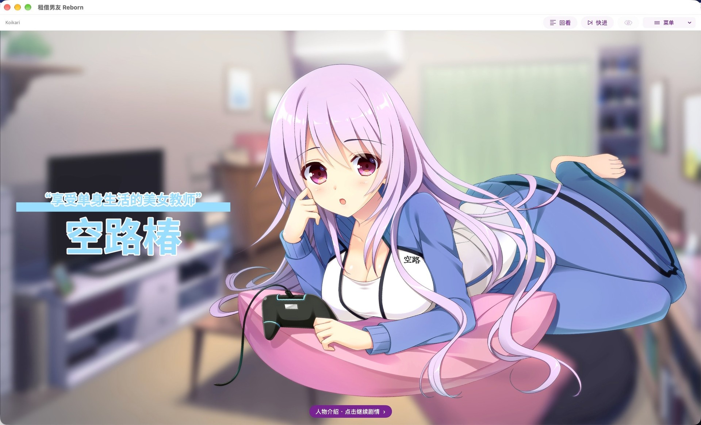

<p align="center"></p>

# Koikari Reborn

[](LICENSE)


**在 macOS、iPhone 和 iPad 上运行《租借男友》（Koikari）的非官方开源运行时。**

基于 Rust + Metal，使用 SwiftUI 原生界面，直接读取用户自己的 XP3 资源，不依赖原 Windows 程序。

> 项目仍处于测试阶段。**应用不附带游戏本体或运行所需的原作资源**，使用前需自行合法取得游戏资源。

[界面预览](#界面预览) · [快速开始](#快速开始) · [基本操作](#基本操作) · [源码构建](#源码构建) · [待修点](#待修点) · [文档与贡献](#文档与贡献)

## 功能

- **剧情与演出**：章节、分支选择、角色路线与结局，以及立绘动画、转场、音视频和片尾字幕。
- **阅读操作**：快进、上一句、历史回看、语音重播，以及隐藏与恢复界面。
- **存档与继续**：6 个手动存档槽、独立自动进度、存档画面预览和继续游戏。
- **CG 与回想**：CG 鉴赏、缩略图浏览和场景回想，随实际剧情进度解锁。
- **个性化设置**：独立音量、对白字号、行间距、对话框不透明度和页码显示。

## 界面预览

用户提供的 macOS 运行截图，点击可查看大图。截图中的原作画面归各自权利人所有，不属于本项目的 MIT 授权范围。

<p align="center">
  <a href=".github/assets/screenshots/title-screen.jpg"></a>
  <br><sub>游戏首页</sub>
</p>

<table>
  <tr>
    <td width="50%" align="center"><a href=".github/assets/screenshots/dialogue.jpg"></a><br><sub>剧情对话</sub></td>
    <td width="50%" align="center"><a href=".github/assets/screenshots/character-introduction.jpg"></a><br><sub>人物介绍</sub></td>
  </tr>
</table>

## 快速开始

### 1. 安装应用

目前以[源码构建](#源码构建)方式提供应用，支持以下平台：

| 平台 | 最低系统 | 说明 |
| --- | --- | --- |
| macOS | macOS 13 | 仅 Apple Silicon（arm64） |
| iPhone | iOS 16 | 需自行配置签名后安装 |
| iPad | iPadOS 16 | 需自行配置签名后安装 |

以上是最低部署配置，不代表所有设备与系统版本均已实测。macOS 构建为临时签名、未经公证；iOS 构建默认未签名，详见[签名与安装](docs/RELEASING.md#签名与安装)。

### 2. 准备资源

将以下文件放在**同一文件夹**，不要嵌套子文件夹：

| 文件 | 是否必需 |
| --- | --- |
| `data.xp3` | 必需，基础资源 |
| `adult.xp3` | 可选，对应补丁资源 |
| `patch.xp3`、`patch1.xp3` … `patch50.xp3` | 可选，更新补丁 |

加载顺序为 `data → adult → patch → patch1 → … → patch50`，后加载的包覆盖同路径资源。补丁只需放入对应 XP3，无需运行原版安装程序。

### 3. 导入并开始游戏

- **macOS**：启动应用，点击「选择资源文件夹」，选择放有 XP3 的文件夹。
- **iPhone / iPad**：先启动一次应用，再打开「文件 → 我的 iPhone / iPad → 租借男友 Reborn → GameResources」，放入 XP3。回到游戏等待检查，或点击「重新检查资源」。重签名后应用文件夹名称可能不同。
- 资源加载成功后，选择「新游戏」；已有有效存档时可选择「继续游戏」。

应用只读访问资源，不额外复制一整份资源包。游玩时不要移动或修改 XP3；更新应用前请备份存档，避免先卸载旧版。

## 基本操作

| 操作 | 界面入口 | macOS 快捷键 |
| --- | --- | --- |
| 推进剧情 | 点击画面或「下一句」 | `Space` / `→` |
| 返回上一句 | 「上一句」 | `←` |
| 开关快进 | 顶栏「快进」 | `F` |
| 回看文字 / 回溯 | 顶栏「回看」 | — |
| 隐藏界面 | 顶栏「隐藏界面」 | — |
| 打开存档 | 菜单 → 存档 | `⌘S` |
| 停止快进 / 恢复界面 | 点击画面 | `Esc` |

快进或隐藏界面时，第一次推进操作只停止快进或恢复界面，不翻页。选项需要手动选择；打开菜单、弹窗或切到后台会暂停剧情。

点击文本框推进异常仍在[待修清单](#待修点)中，可先使用「下一句」或快捷键。

**存档注意**：不兼容原版游戏存档。存档绑定当前资源组合；更换或增减补丁后，可能需要切回原组合才能读档。

## 源码构建

需要 **Apple Silicon Mac、完整 Xcode（含所需 SDK）、Rust 1.88+ / rustup、Python 3**。Opus 依赖使用 CMake 3.x，以下命令会在项目内隔离安装。

```sh
git clone https://github.com/Greendot-galgame/Koikari-Reborn.git
cd Koikari-Reborn

python3 -m venv .build-tools
.build-tools/bin/pip install cmake==3.31.10
export PATH="$PWD/.build-tools/bin:$HOME/.cargo/bin:$PATH"

# 构建并启动 macOS 版
CONFIGURATION=Release scripts/build-apple.sh macosx
open target/xcode-macosx/Build/Products/Release/KoikariReborn.app
```

其他目标按需构建：

```sh
CONFIGURATION=Release scripts/build-apple.sh iphonesimulator  # Apple Silicon 模拟器
CONFIGURATION=Release scripts/build-apple.sh iphoneos        # iPhone / iPad 真机
```

构建脚本会安装对应 Rust target，并打印应用产物路径；未指定 `CONFIGURATION` 时为 Debug。真机安装需在 Xcode 打开 [KoikariReborn 工程](apple/KoikariReborn.xcodeproj)，选择同名 scheme 并配置自己的 Team 与签名。

开发检查、真实资源测试和已验证范围见[测试文档](docs/TESTING.md)；代码分层见[架构文档](docs/ARCHITECTURE.md)。

## 当前限制

- 这是针对《租借男友》的运行时，不是通用 KiriKiri / TJS 引擎，不支持任意游戏或插件。
- 部分界面与交互仍待完善；真机、实际声音、全部输入组合及媒体中断场景尚未完成验证，详见[测试范围](docs/TESTING.md#仍未关闭的范围)。
- 已发现部分原作资源存在音频损坏、音效缺失或基础版 OP 损坏，详见[已知资源缺陷](docs/TESTING.md#已知资源缺陷)。遇到错误会明确提示，不修改原资源或绕过校验。

## 待修点

1. 修复点击文本框无法推进剧情的问题。
2. 修复快进时“隐藏对话框”按钮一直闪烁的问题。
3. 修复点击对话框时偶尔闪现空白旁白的问题。
4. 删除“旁白”这两个字，保留旁白内容。
5. 支持在设置中调整对话框大小，并保持尺寸稳定，避免因人物挤占空间而变化。
6. 适当缩小对话框的默认宽度。
7. 适当增大默认字号。
8. 优化对话框的文字排版。
9. 删除首页的“Koikari Reborn”文字，保持界面简洁。
10. 支持在设置中调节快进速度。
11. 为人物介绍页面的对话框设计专属 UI。
12. 为场景回想页面增加预览图片。
13. CG 预览支持查看大图。

## 文档与贡献

- [架构说明](docs/ARCHITECTURE.md) · [测试与覆盖范围](docs/TESTING.md) · [发布流程](docs/RELEASING.md)
- [贡献指南](CONTRIBUTING.md)：开发约定与提交要求，欢迎提交 Issue 和 PR。
- [问题反馈](https://github.com/Greendot-galgame/Koikari-Reborn/issues/new/choose)：请附版本、平台、复现步骤和脱敏错误信息，不要上传原作资源或存档。
- [安全报告](SECURITY.md)：安全问题请按指引私下报告。

## 许可证

本项目新实现的代码与文档采用 [MIT](LICENSE) 许可证；第三方依赖保留各自许可证。原作资源、角色、商标等权利归各自权利人，本项目并非官方移植，也不提供资源下载、解密或 DRM 绕过。详见[资源与授权边界](docs/RESOURCE_POLICY.md)。
