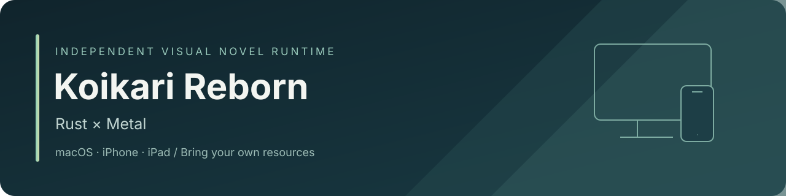
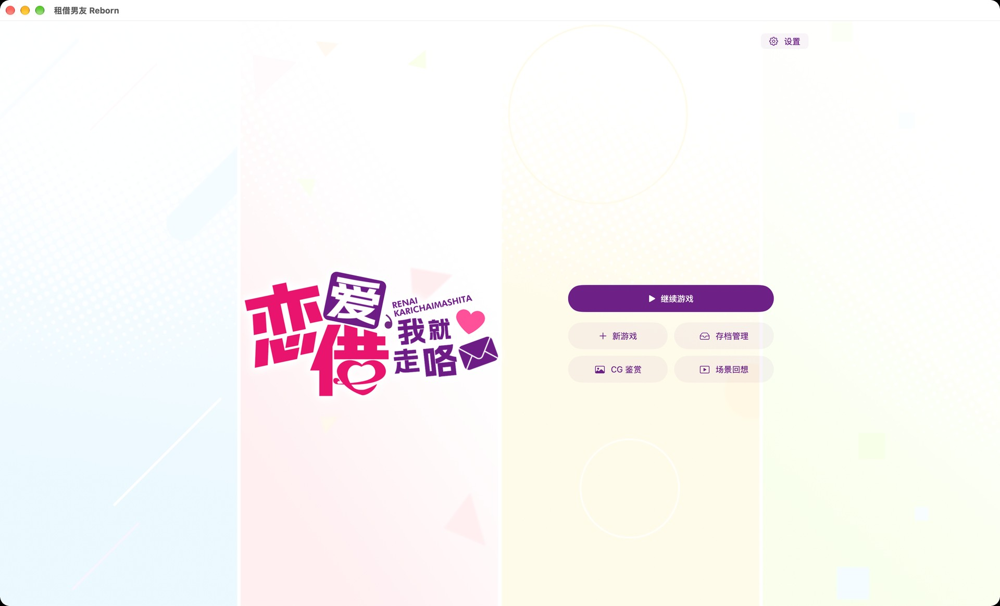
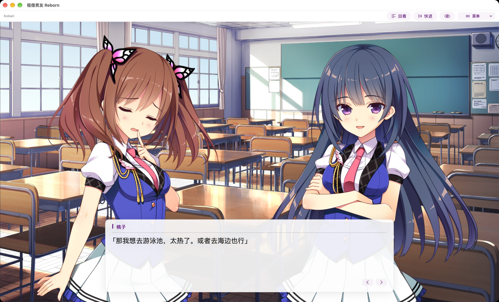

<p align="center">
  
</p>

<h1 align="center">Koikari Reborn</h1>

<p align="center">
  <strong>在 macOS、iPhone 和 iPad 上运行《租借男友》（Koikari）的非官方开源运行时</strong>
</p>

<p align="center">
  Rust + Metal 渲染 · SwiftUI 原生界面 · 直接读取自有 XP3 资源
</p>

<p align="center">
  <a href="LICENSE"></a>
  
  
</p>

> **测试阶段**：本项目不附带游戏本体或运行所需的原作资源，请自行合法取得。

<p align="center">
  <a href="#界面预览">界面预览</a> ·
  <a href="#功能">功能</a> ·
  <a href="#快速开始">快速开始</a> ·
  <a href="#基本操作">基本操作</a> ·
  <a href="#源码构建">源码构建</a> ·
  <a href="#文档与许可证">文档与许可证</a>
</p>

## 界面预览

<p align="center">
  <a href=".github/assets/screenshots/title-screen.jpg">
    
  </a>
  <br><sub>游戏首页</sub>
</p>

<table>
  <tr>
    <td width="50%" align="center">
      <a href=".github/assets/screenshots/dialogue.jpg">
        
      </a>
      <br><sub>剧情对话</sub>
    </td>
    <td width="50%" align="center">
      <a href=".github/assets/screenshots/character-introduction.jpg">
        
      </a>
      <br><sub>人物介绍</sub>
    </td>
  </tr>
</table>

<sub>截图截取自 build 18。原作画面归各自权利人所有，不属于本项目 MIT 授权范围。</sub>

## 功能

| 模块 | 能力 |
| :--- | :--- |
| **剧情与演出** | 章节、分支、角色路线与结局；立绘动画、转场、音视频和片尾字幕。 |
| **阅读** | 点击推进、上一句、历史回看、语音重播、快进与隐藏界面。 |
| **人物介绍与鉴赏** | 专属人物介绍卡、CG 缩略图与大图查看、带预览的场景回想。 |
| **存档** | 6 个手动槽位、独立自动进度、存档画面预览和继续游戏。 |
| **设置** | 音量、对白字号、对话框大小、行间距、不透明度、页码和快进速度。 |

## 快速开始

支持 **macOS 13+（Apple Silicon）**、**iOS / iPadOS 16+**。目前需[源码构建](#源码构建)；macOS 为临时签名、未经公证，iOS 需自行配置签名。最低配置不代表所有设备与系统版本均已实测。

### 1. 准备资源

把 XP3 放在**同一文件夹**：

| 文件 | 说明 |
| :--- | :--- |
| `data.xp3` | 必需，基础资源 |
| `adult.xp3` | 可选，补丁资源 |
| `patch.xp3` … `patch50.xp3` | 可选，更新补丁 |

加载顺序为 `data → adult → patch → patch1 → …`，后加载的包覆盖同路径资源。

### 2. 导入资源

| 平台 | 操作 |
| :--- | :--- |
| **macOS** | 启动应用，点击「选择资源文件夹」 |
| **iPhone / iPad** | 「文件」→ 我的 iPhone / iPad → 租借男友 Reborn → `GameResources`，放入 XP3 后回到游戏检查 |

### 3. 开始游戏

资源载入后选择「新游戏」；已有有效存档时可选择「继续游戏」。应用只读访问资源，不额外复制资源包。

> **存档提示**：不兼容原版游戏存档；存档绑定当前资源组合，更换补丁后可能需要切回原组合才能读档。更新前建议备份 `~/Library/Application Support/KoikariReborn`。

## 基本操作

| 操作 | 入口 | macOS 快捷键 |
| :--- | :--- | :--- |
| 推进剧情 | 点击画面、对话框或「下一句」 | `Space` / `→` |
| 上一句 | 对白框「上一句」 | `←` |
| 快进 | 顶栏「快进」 | `F` |
| 回看 / 回溯 | 顶栏「回看」 | — |
| 隐藏界面 | 顶栏「隐藏界面」 | — |
| 存档 | 菜单 → 存档 | `⌘S` |
| 停止快进 / 恢复界面 | 点击画面 | `Esc` |

快进或隐藏界面时，第一次推进只停止快进或恢复界面，不翻页。对话框可整块轻点，长对白可上下滚动；选项需要手动选择，打开菜单或切到后台会暂停剧情。

## 源码构建

**环境**：Apple Silicon Mac、完整 Xcode、Rust 1.88+ / rustup、Python 3、CMake 3.x。

```sh
git clone https://github.com/Greendot-galgame/Koikari-Reborn.git
cd Koikari-Reborn

# 在项目内隔离安装 CMake
python3 -m venv .build-tools
.build-tools/bin/pip install cmake==3.31.10
export PATH="$PWD/.build-tools/bin:$HOME/.cargo/bin:$PATH"

# 构建并启动 macOS 版
CONFIGURATION=Release scripts/build-apple.sh macosx
open target/xcode-macosx/Build/Products/Release/KoikariReborn.app
```

iOS 模拟器 / 真机使用 `scripts/build-apple.sh iphonesimulator` / `iphoneos`；真机需在 Xcode 中配置 Team 与签名。开发检查见[测试文档](docs/TESTING.md)，代码分层见[架构文档](docs/ARCHITECTURE.md)。

## 当前限制

- 这是《租借男友》的专用运行时，不是通用 KiriKiri / TJS 引擎，不支持任意游戏或插件。
- 部分界面、真机、实际声音和媒体中断场景尚未完整验证，详见[测试范围](docs/TESTING.md#仍未关闭的范围)。
- 部分原作资源存在音频损坏、音效缺失或基础版 OP 损坏；遇到错误会明确提示，不修改或绕过资源校验。

## 文档与许可证

| 文档 | 内容 |
| :--- | :--- |
| [架构说明](docs/ARCHITECTURE.md) | Rust / 原生分层与关键边界 |
| [测试与覆盖范围](docs/TESTING.md) | 已验证项、限制与未关闭范围 |
| [发布流程](docs/RELEASING.md) | 构建、签名与安装 |
| [贡献指南](CONTRIBUTING.md) | 开发约定与提交要求 |
| [资源与授权边界](docs/RESOURCE_POLICY.md) | 原作资源、截图与许可说明 |
| [安全报告](SECURITY.md) | 安全问题私下报告 |

问题反馈请附版本、平台、复现步骤和脱敏错误信息，不要上传原作资源或存档：[提交 Issue](https://github.com/Greendot-galgame/Koikari-Reborn/issues/new/choose)。

本项目新实现的代码与文档采用 [MIT](LICENSE) 许可证；第三方依赖保留各自许可证。原作资源、角色和商标归各自权利人，本项目并非官方移植，也不提供资源下载、解密或 DRM 绕过。
