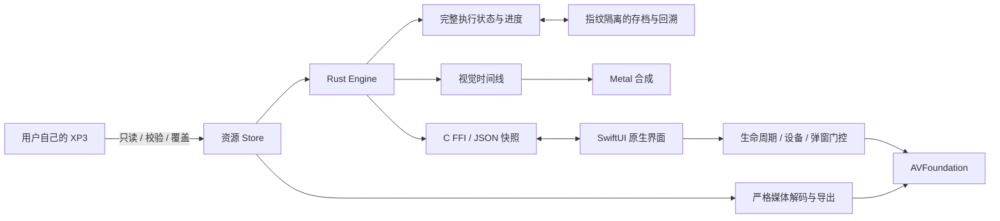

# 架构

[返回首页](../README.md)

这是针对《租借男友》实际脚本集合实现的独立运行时，不执行原 Windows 程序，不是完整 TJS2 虚拟机或任意 KiriKiri 插件兼容层。

## 模块地图

| 路径 | 负责的边界 |
| --- | --- |
| `src/xp3.rs` | 索引、segment、解压、校验、安全路径、数字覆盖与资源指纹 |
| `src/kag.rs`, `events.rs`, `tjs.rs` | KAG 指令、事件数据库及受限表达式/变量求值 |
| `src/story.rs` | 解释器、章节/调用栈、条件、选项、计时器、路线、结局和回放 |
| `src/model.rs`, `save.rs` | 执行状态、进度、版本化存档、原子写入与恢复校验 |
| `src/animation.rs`, `renderer.rs`, `scene.metal` | 可保存的视觉时间线、裁剪、图层及 Metal 绘制 |
| `src/media.rs` | Opus/Vorbis 解码、视频校验、受控导出与缓存 |
| `src/coverage.rs` | 使用实际 Engine API 的有限预算路线遍历 |
| `src/ffi.rs`, `apple/Koikari.h` | Rust/native 所有权和调用边界 |
| `apple/KoikariApp.swift` | UI、输入、快进、原生播放器与统一恢复策略 |
| [GameUI.swift](../apple/GameUI.swift)、[TitleScreen.swift](../apple/TitleScreen.swift)、[SettingsView.swift](../apple/SettingsView.swift) | 统一主题、共享对白组件、标题/资源引导和设置预览；视图不直接操作 Rust 状态 |
| [GameMenus.swift](../apple/GameMenus.swift) | 共享页头的存读档卡片、回看/完整文字切换、CG/回想网格及文档页；保留确认、禁用条件和原有引擎命令，预览可独立渲染真实视图 |
| [GalleryThumbnails.swift](../apple/GalleryThumbnails.swift) | 仅处理独立图片字节，不持有 Host；主线程按需取数据、后台串行解码、重复请求合并与有界 LRU；资源切换/关闭清理队列与缓存，视图另用代际标记拒绝旧图片 |
| [ReadingPolicy.swift](../apple/ReadingPolicy.swift) | 可无资源测试的隐藏界面资格、输入意图和阅读布局；隐藏不修改引擎的消息可见性 |
| [OriginalUI.swift](../apple/OriginalUI.swift) | 从当前连接的 Store 加载两个可选标题图片；FFI 名称白名单与解压后 8 MiB 上限，ImageIO 解码前检查单帧、边长 4096 和 4M 像素上限；连接切换替换整组图片，无素材时回退原生 UI |
| `apple/GameVideo.swift`, `CreditsView.swift` | 原生视频生命周期及片尾显示 |
| `apple/AssetImport.swift`, `AssetLocation.swift` | 可取消导入、相对资源标识及旧路径迁移 |

## 必须保持的不变量

1. **资源只读且严格校验。** 后包覆盖同路径条目；不读取原始程序，不解密受保护资源，不关闭 Adler-32/Ogg 校验。
2. **剧情状态是唯一事实来源。** 画面、选项、计时器与播放器由快照驱动；不能用 UI 跳章或假解锁代替执行。
3. **恢复是事务。** 先验证存档、资源指纹和回溯序列，成功后才替换活动 Engine；失败不破坏现有状态或源存档。
4. **页号不等于提交状态。** 当前页面仍在构建时，可与上一已提交 checkpoint 共用页号；不能因此允许未来、重复、无序或未提交 checkpoint。
5. **媒体失败有明确语义。** 资源损坏按片段 Skip/Retry；输出设备失败按全局恢复处理。静音/零音量不启动播放器，不伪造解码成功。
6. **回调绑定身份。** 过期音视频回调不得影响新的片段，播放失败不能当作 EOF。
7. **进度来自真实执行。** 回溯丢弃未来分支，但不会撤销已自然获得的 CG/回想；新游戏和标题不清空同指纹全局进度。

## CG 缩略图边界

`kr_gallery_image` 只接受当前图库中真实已解锁的条目 ID，每次重新解析代表图片，不接受调用者给定的资源路径。Store 在读取前限制解压后资产为 32 MiB，保留补丁优先级、保护标志和校验失败拒绝；返回字节使用原始长度释放。该接口不绘图、不切换图库预览，也不执行剧情或保存进度。

Swift 的按需读取闭包只在主线程执行；复制后的独立数据才交给后台解码。ImageIO 解码前限制单帧、边长 8192、16M 像素；缩略图按完整画面和方向信息缩至最长边 384，不裁切。缓存最多 32 项且按真实行字节数计费不超过 16 MiB，视图离屏释放显示图片；这些是局部预算，不代表原生界面、ImageIO 临时缓冲及 GPU 的总内存上限。清理期间已经开始的同步解码可以完成，但旧结果不得回到新一代界面，也不得与后续解码重叠。

## 平台与限制

Rust 核心可以在无界面环境中验证合成脚本；Metal 和原生壳使用 Apple SDK。交付构建为 arm64 macOS、iOS Simulator 与 iPhoneOS。系统最低部署版本不等于该版本已实测。

宽图集只在存在明确帧几何时裁剪，避免创建超过设备限制的整张 GPU texture。原生音视频的精确播放偏移不写入存档。完整的设备内存、声音与中断验收参见[测试范围](TESTING.md)。

人物底图、表情、红晕和附加贴片先在原始坐标合成，再由 Metal 进行缩放、移动、整体透明度、滤色和转场。仅合成可见区域，按固定块对齐并保留采样边界，避免子像素运动反复生成纹理；源图逐张有界解码，不重复驻留 GPU。当前/上一场景的最终纹理共同计入原 256 MiB 资产缓存预算；固定场景画布、drawable、CPU 与媒体内存单独计算，不把该预算当作设备内存安全证明。
