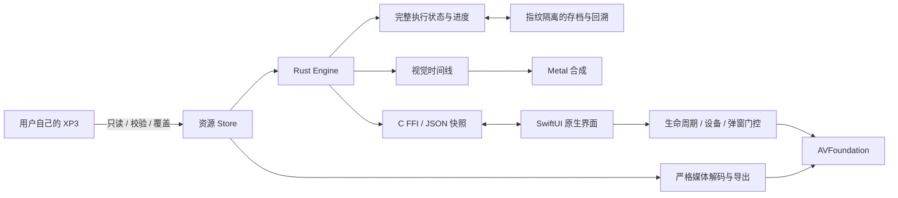

# 架构

[返回首页](../README.md)

这是针对《租借男友》实际脚本集合实现的独立运行时，不执行原 Windows 程序，不是完整 TJS2 虚拟机或任意 KiriKiri 插件兼容层。

## 模块地图

| 路径 | 负责的边界 |
| --- | --- |
| `src/xp3.rs` | 索引、segment、解压、校验、安全路径、数字覆盖与资源指纹 |
| `src/kag.rs`, `events.rs`, `tjs.rs` | KAG 指令、事件数据库及受限表达式/变量求值 |
| `src/story.rs` | 解释器、章节/调用栈、条件、选项、计时器、路线、结局和回放 |
| `src/model.rs`, `save.rs` | 执行状态、进度、版本化存档、原子写入与恢复校验 |
| `src/animation.rs`, `renderer.rs`, `scene.metal` | 可保存的视觉时间线、裁剪、图层及 Metal 绘制 |
| `src/media.rs` | Opus/Vorbis 解码、视频校验、受控导出与缓存 |
| `src/coverage.rs` | 使用实际 Engine API 的有限预算路线遍历 |
| `src/ffi.rs`, `apple/Koikari.h` | Rust/native 所有权和调用边界 |
| `apple/KoikariApp.swift` | UI、输入、快进、原生播放器与统一恢复策略 |
| [GameUI.swift](../apple/GameUI.swift)、[TitleScreen.swift](../apple/TitleScreen.swift)、[SettingsView.swift](../apple/SettingsView.swift) | 统一主题、共享对白组件、标题/资源引导和设置预览；视图不直接操作 Rust 状态 |
| [GameMenus.swift](../apple/GameMenus.swift) | 共享页头的存读档卡片、回看/完整文字切换、CG/回想网格及文档页；保留确认、禁用条件和原有引擎命令，预览可独立渲染真实视图 |
| [GalleryThumbnails.swift](../apple/GalleryThumbnails.swift) | 仅处理独立图片字节，不持有 Host；主线程按需取数据、后台串行解码、重复请求合并与有界 LRU；资源切换/关闭清理队列与缓存，视图另用代际标记拒绝旧图片 |
| [SaveThumbnails.swift](../apple/SaveThumbnails.swift) | 主线程取得精确存档版本的不可变租约，仅把 Scene + Arc\<Store\> 的所有权交给后台；独占渲染后在同一 worker 释放租约，输出字节用原始长度释放；不传递活跃 Host |
| [ReadingPolicy.swift](../apple/ReadingPolicy.swift) | 可无资源测试的隐藏界面资格、输入意图和阅读布局；隐藏不修改引擎的消息可见性 |
| [OriginalUI.swift](../apple/OriginalUI.swift) | 从当前连接的 Store 加载两个可选标题图片；FFI 名称白名单与解压后 8 MiB 上限，ImageIO 解码前检查单帧、边长 4096 和 4M 像素上限；连接切换替换整组图片，无素材时回退原生 UI |
| `apple/GameVideo.swift`, `CreditsView.swift` | 原生视频生命周期及片尾显示 |
| `apple/AssetImport.swift`, `AssetLocation.swift` | 可取消导入、相对资源标识及旧路径迁移 |

## 必须保持的不变量

1. **资源只读且严格校验。** 后包覆盖同路径条目；不读取原始程序，不解密受保护资源，不关闭 Adler-32/Ogg 校验。
2. **剧情状态是唯一事实来源。** 画面、选项、计时器与播放器由快照驱动；不能用 UI 跳章或假解锁代替执行。
3. **恢复是事务。** 先验证存档、资源指纹和回溯序列，成功后才替换活动 Engine；失败不破坏现有状态或源存档。
4. **页号不等于提交状态。** 当前页面仍在构建时，可与上一已提交 checkpoint 共用页号；不能因此允许未来、重复、无序或未提交 checkpoint。
5. **媒体失败有明确语义。** 资源损坏按片段 Skip/Retry；输出设备失败按全局恢复处理。静音/零音量不启动播放器，不伪造解码成功。
6. **回调绑定身份。** 过期音视频回调不得影响新的片段，播放失败不能当作 EOF。
7. **进度来自真实执行。** 回溯丢弃未来分支，但不会撤销已自然获得的 CG/回想；新游戏和标题不清空同指纹全局进度。

## CG 缩略图边界

`kr_gallery_image` 只接受当前图库中真实已解锁的条目 ID，每次重新解析代表图片，不接受调用者给定的资源路径。Store 在读取前限制解压后资产为 32 MiB，保留补丁优先级、保护标志和校验失败拒绝；返回字节使用原始长度释放。该接口不绘图、不切换图库预览，也不执行剧情或保存进度。

Swift 的按需读取闭包只在主线程执行；复制后的独立数据才交给后台解码。ImageIO 解码前限制单帧、边长 8192、16M 像素；缩略图按完整画面和方向信息缩至最长边 384，不裁切。缓存最多 32 项且按真实行字节数计费不超过 16 MiB，视图离屏释放显示图片；这些是局部预算，不代表原生界面、ImageIO 临时缓冲及 GPU 的总内存上限。清理期间已经开始的同步解码可以完成，但旧结果不得回到新一代界面，也不得与后续解码重叠。

## 对白、人物介绍与鉴赏边界

对白框的几何完全由 [ReadingPolicy.swift](../apple/ReadingPolicy.swift) 的 `ReadingLayout` 计算：只接收画布尺寸、Dynamic Type、字号、行距和用户「对话框大小」，不接收当前文本、说话人或立绘位置。SwiftUI 视图负责在固定框内滚动和重新置顶；人物立绘的 `fc` 位置不再为对白框让出宽度。`canOfferHide` 只用于工具栏的稳定可用状态，实际 `hideInterface` 仍使用严格的 `canHide`（还要求当前消息可见且不在计时等待），因此逐页的等待状态不会让按钮闪烁，也不会把不可隐藏的页面误标为可隐藏。

人物介绍仍是引擎的 `interlude` 状态，不新增剧情分支。Swift 只在快进/选择/视频等阻塞条件下显示独立的 `GameInterludePanel`：有文本时按脚本写入的两行拆成说明与引语，使用与阅读框一致的浅色半透明卡和紫色强调；无文本的单图介绍只显示轻量「轻触继续」胶囊；两者都通过同一 `game.next()` 进入下一页。

`GalleryEntry.preview` 是引擎从事件脚本静态解析的代表图：优先首个 `evNNN_N` CG，退而取首个背景；不执行脚本、不读取锁定资源，按 2 MiB 和 16,000 行上限扫描，并按当前 Store 缓存结果。`kr_replay_image` 只接受 `kr_replays` 中已解锁的 ID，在读取前限制 32 MiB；Swift 复用有界缩略图管线。CG「查看大图」仍通过 `kr_gallery_image` 取同一已解锁资产，只把最长边从 384 提高到 1920，使用独立缓存，不启动第二个 Metal renderer。快进速度由 `FastForwardPolicy` 把 1×–5× 映射为 250–50 ms 的页面步进，不改变等待、选项或视频的语义。

## 游玩菜单的呈现与输入边界

iOS 游玩菜单由稳定的根视图呈现原生 sheet，而不是挂在随故事快照刷新、布局适配变化的临时系统 Menu 上。菜单视图只接收必要的值和动作回调，不继承背景工具栏的 `modalOpen` 禁用状态。打开操作同步暂停剧情时钟、媒体和快进；图片仍可绘制冻结的场景。

[ReadingPolicy.swift](../apple/ReadingPolicy.swift) 中的 `GameplayMenuPresentation` 区分关闭、已呈现、正在关闭三种阶段。选择操作只入队，保持暂停直到系统触发 `onDismiss`，再执行真实目标路由；目标弹层标记先设置，之后才同步暂停状态，避免中间恢复一帧剧情。静音/重播语音在关闭菜单门控后分发，仍服从独立的前后台和系统中断策略。重复选择/关闭回调不重复执行动作，取消不会执行动作，关闭期间新出现的错误、导入或其他弹层会取消待处理选择。存档列表读取失败不同时打开存档页和错误提示。

## 存档缩略图边界

存档列表的可选 `preview_revision` 是同一次有界读取所得原始存档字节的 SHA256，经过正常结构、资源指纹和 Engine 验证后才发布；不依赖页码或时间戳判定图片身份。共用读取路径不修改存档格式、版本或文件。需要迁移的旧记录、标题/阻塞状态和无法复现的原生视频/片尾/人物介绍不发布图片版本，但不因此改变原有的读档兼容性。

`kr_save_preview_request` 只在主线程重新读取指定槽并比对版本，复制已保存 Scene 和不可变 Store 引用，不恢复剧情或借用活跃 Renderer。worker 通过 `kr_save_preview_png` 借用租约，在独立 Metal renderer 中按保存时的视觉时钟完整合成背景、角色、上一画面及效果，输出 384×216、至多 1 MiB 的 PNG；所有路径最终调用 `kr_save_preview_free`。存档覆写和 Host 关闭不会使已取得的租约悬空，也不能把旧结果绘到新一代卡片。

后台工作复用可取消、合并请求的缩略图队列，准备闭包留在 MainActor；仅独立数据或不可变租约进入 worker。存档页关闭、资源切换和列表重载清理图片与队列；自动保存时只有正在展示的存档页额外刷新列表，以处理不伴随场景重激活的音频中断。原生图片缓存仍有 32 项/16 MiB 上限。

预览专用 renderer 使用 48 MiB 软/64 MiB 硬资产纹理预算，编码图片在 XP3 解压前限制为 32 MiB。为保持 shader 一致性，保留两张标准画布（合计 29,491,200 字节），CPU 解码、输出纹理和系统内存另计。全局互斥覆盖 GPU 创建、渲染、销毁及 autorelease-pool 清理；超限、校验或渲染失败只返回占位，不输出部分图像。正常游戏 renderer 的原有预算和行为不变。

## 平台与限制

Rust 核心可以在无界面环境中验证合成脚本；Metal 和原生壳使用 Apple SDK。交付构建为 arm64 macOS、iOS Simulator 与 iPhoneOS。系统最低部署版本不等于该版本已实测。

宽图集只在存在明确帧几何时裁剪，避免创建超过设备限制的整张 GPU texture。原生音视频的精确播放偏移不写入存档。完整的设备内存、声音与中断验收参见[测试范围](TESTING.md)。

人物底图、表情、红晕和附加贴片先在原始坐标合成，再由 Metal 进行缩放、移动、整体透明度、滤色和转场。仅合成可见区域，按固定块对齐并保留采样边界，避免子像素运动反复生成纹理；源图逐张有界解码，不重复驻留 GPU。当前/上一场景的最终纹理共同计入原 256 MiB 资产缓存预算；固定场景画布、drawable、CPU 与媒体内存单独计算，不把该预算当作设备内存安全证明。
